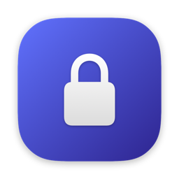
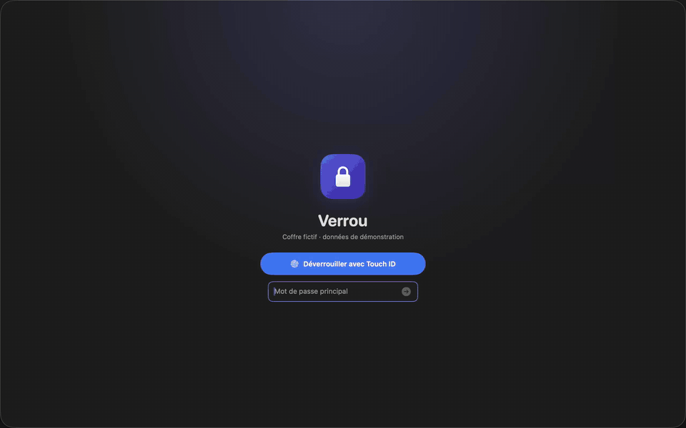
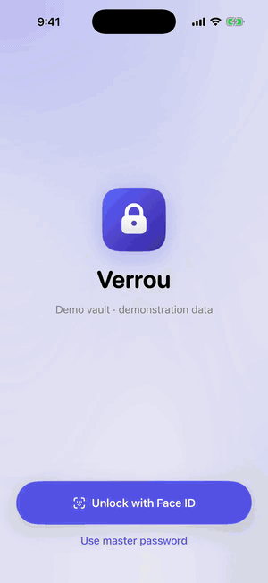
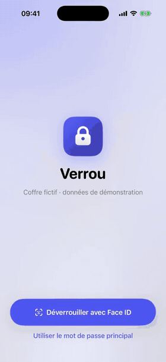
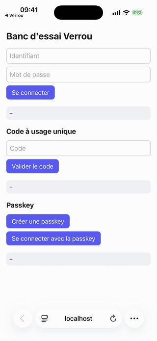

<p align="center">
  
</p>

<h1 align="center">Verrou</h1>

<p align="center"><b>Your Vaultwarden vault, native on your Mac.</b></p>

<p align="center">
  A fast macOS password manager for a self-hosted
  <a href="https://github.com/dani-garcia/vaultwarden">Vaultwarden</a> server,
  with a Brave and Firefox extension, a command line and an SSH agent, all built around a
  Rust core and Bitwarden's official crypto.
</p>

<p align="center">
  <a href="https://verrou.bonout.com"><b>Website</b></a> ·
  <a href="https://github.com/bonout/verrou/releases/latest"><b>Download</b></a> ·
  <a href="#install">Install</a> ·
  <a href="docs/GUIDE.md">Full guide</a> ·
  <a href="SECURITY.md">Security</a>
</p>

<p align="center">
  <a href="docs/media/demo.mp4">
    
  </a>
</p>

Verrou works with the vault you already have on your Vaultwarden server, so
the official Bitwarden apps and web vault keep working next to it. It opens
in a fraction of a second, searches thousands of items as you type, and fills
your logins in Brave, Firefox and any other Mac app. The interface is in French.

## What you can do

- **Unlock** with Touch ID, a YubiKey (FIDO2 PIN and a touch) or your master
  password. It locks itself after inactivity, on sleep and with the screen.
- **Find anything as you type**: fuzzy, accent-insensitive search, under
  5 ms on 10,000 items, with filters like `type:carte` or `dossier:maison`.
- **Quick Access** (⌘⇧Space) from any app: search, then copy a password or a
  one-time code without opening the main window.
- **Fill in any app** (⌘\\): Verrou types the username and password into the
  app in front of you, like 1Password's Universal Autofill.
- **Fill in Brave and Firefox**: logins, one-time codes, cards and addresses,
  from a 1Password-style pill at the top left of the page (*Sign in*,
  other logins in a tab under it; logins are submitted once filled, unless
  something is left to type or a captcha shows, which can be turned off in
  the popup), with only a small Verrou icon in the field:
  nothing gets in the way of the site's own suggestion lists. It suggests
  strong passwords, offers to save new accounts, and reads two-factor QR codes
  shown on a page (Brave).
- **Passkeys in Brave and Firefox**: create and use passkeys stored in your vault, in the
  Bitwarden format, so they work with the official apps too. Sites with
  passkey autofill get them as the pill's top suggestion, before passwords.
  In Brave, the extension reloads itself when Verrou is updated.
- **Audit your vault**: reused, weak and old passwords, plain-HTTP sites,
  known breaches (Have I Been Pwned), expiring cards, and sites that offer
  two-factor authentication you haven't turned on. *Change Password*
  opens the site's change-password page in one click, and the extension then
  suggests a strong password and saves it.
- **Share**: shared vaults with family or a team (Vaultwarden organizations):
  create an organization, its collections and groups, share one item or a
  whole selection into it, and choose who sees what (view, hide passwords,
  edit, manage). *Remove from Sharing* moves items back to your personal
  vault, re-encrypted under your key with their history, passkeys, codes,
  fields and attachments. Also encrypted links that expire for a text or a file
  (Send), and emergency access for trusted contacts.
- **Bring people in**: invite them to a shared vault, choose their role and
  collections, and confirm them after checking their key's fingerprint
  phrase. Invited people create their account from Verrou's sign-in screen,
  even on a server with sign-ups closed, with no admin token; people who
  already have an account join by pasting the invitation link.
- **Hear about it**: local notifications when you get access to a shared
  vault, when someone waits for your confirmation, when new items are shared
  with you, and for emergency access requests (Mac). Computed on the device
  after each sync, never through a push service; on the Mac they arrive
  within seconds through Vaultwarden's live notifications channel.
- **Store more than passwords**: cards, identities, secure notes, SSH keys,
  attachments and documents, Wi-Fi networks (with a QR code to join),
  passports, licenses, bank accounts, servers, API keys, and custom fields on
  any item.
- **Act on many items at once**: select them like in Finder, then archive,
  trash, restore, favorite or move them to a folder in one go.
- **Find your passkeys**: a *Passkeys* list with a count (site and user name
  on each row), and `passkey:github` or `has:passkey` in the search.
- **Sort your way**: by relevance, title, modification, creation or last use
  (what you filled, copied or revealed on this device, kept only there), and
  open the list you want at unlock.
- **Choose where a login is offered**: Bitwarden's per-site match rule
  (base domain, host, starts with, exact, regular expression, never), a
  default for the device and one per folder, and your account's equivalent
  domains, honoured by the extension, ⌘\ and iPhone AutoFill alike.
- **Save without waiting**: edits show at once and are sent to the server
  in the background, so a slow link never holds up the window.
- **Work offline**: edit, create, trash or archive items without network;
  changes are synced, in order, as soon as the server answers.
- **Generate** strong passwords or memorable passphrases (French or English
  words, like `fixe-pivoine-monceaux-couteau-ponctue`), with their real
  strength, in the app and with `verrou generate`.
- **Move in**: import from Apple Passwords, 1Password and Proton Pass, then
  clean up duplicates: the same account under different URLs, titles or
  usernames is found (certain, probable, to check) and merged into one item.
- **Work from the terminal**: `verrou search`, `get` and `totp`, an SSH agent
  that signs with the keys in your vault, and git commit signing. Each secret
  is approved with Touch ID. `verrou run` hands secrets to a command in its
  environment, masked in its output: they never land in the terminal or in
  an AI agent's context (`GITHUB_TOKEN=verrou://GitHub/token verrou run --
  gh repo list`).
- **Approve from your iPhone**: away from the Mac (screen locked or idle),
  the terminal's requests go to Verrou on the paired iPhone, where Face ID
  approves them; it can also unlock the vault for the terminal, without the
  vault key ever leaving the Mac. Through your own iCloud account, sealed
  end to end ([details](SECURITY.md#approving-from-the-iphone)).

## Private

Your vault is decrypted only on your Mac, by Bitwarden's official Rust SDK.
Verrou talks to your own server, with two exceptions:

- **Breach checks** send only the first 5 characters of a password's SHA-1
  hash to Have I Been Pwned. The whole vault is checked when you ask; new
  passwords are checked automatically, which you can turn off in Settings.
- **The audit** downloads the public [2fa.directory](https://2fa.directory)
  list and its [passkeys directory](https://passkeys.2fa.directory), at most
  once a week each, as whole files: it never asks about your sites one by one.
- **Change Password** asks only the site you are about to open
  whether it has a [change-password page](https://w3c.github.io/webappsec-change-password-url/),
  and only when you click. **Create a Passkey** does the same for the site's
  [passkey page](https://w3c.github.io/webappsec-passkey-endpoints/)
  (`/.well-known/passkey-endpoints`).

The browser extension only receives the logins of the site in front of it, over
an end-to-end encrypted channel. Copied secrets are hidden from clipboard
managers and cleared after 90 seconds. Details and known limits are in
[SECURITY.md](SECURITY.md).

## Install

Every release is on the [Releases page](https://github.com/bonout/verrou/releases/latest),
with `SHA256SUMS` and a build attestation for each file
(`gh attestation verify <file> -R bonout/verrou`).

### Mac app

1. Download `Verrou-<version>-macos.dmg` (macOS 15 or later), open it and drag
   Verrou to Applications. It is signed with a Developer ID and notarized by
   Apple: it opens without a warning.
2. Open Verrou and enter your server address, e-mail and master password,
   then your second factor. Touch ID unlocks it from then on.

Verrou updates itself: it checks GitHub once a day, downloads a new version
in the background and installs it when you quit the app, after checking its
signature (Settings → General → Updates).

Optional, from Verrou's Settings:

- **Brave, Chrome or Firefox extension**: *Browsers and Terminal*, then follow
  the steps shown there. The release also has `verrou-<version>-chromium.zip`
  (load it unpacked) and `verrou-<version>-firefox.xpi`, signed by Mozilla:
  open it in Firefox 128+ to install it for good
  ([guide](docs/GUIDE.md#brave-extension)).
- **Fill in any app** (⌘\\): allow Verrou in System Settings → Privacy &
  Security → Accessibility ([guide](docs/GUIDE.md#fill-in-any-app)).
- **Safari and Mac apps**: turn on Verrou in System Settings → General →
  AutoFill & Passwords.

### Command line and SSH agent

The Mac app ships the `verrou` command and keeps it up to date with itself:
in Verrou's Settings, *Browsers and Terminal* → *Command line* → *Copy
Command*, paste it in Terminal (it links `/usr/local/bin/verrou` to the app),
then run `verrou link` once and compare the code shown in Verrou.

Without the Mac app (Linux, or a machine of its own), download the archive
for your machine (`aarch64-apple-darwin` for Apple
silicon, `x86_64-apple-darwin` for Intel Macs, `x86_64-unknown-linux-gnu`),
then put `verrou` on your `PATH`:

```sh
v=$(curl -fsSL https://api.github.com/repos/bonout/verrou/releases/latest | sed -n 's/.*"tag_name": *"v\([^"]*\)".*/\1/p')
t=aarch64-apple-darwin
curl -LO https://github.com/bonout/verrou/releases/download/v$v/verrou-$v-$t.tar.gz
tar -xzf verrou-$v-$t.tar.gz
install -m 755 verrou-$v-$t/verrou ~/.local/bin/verrou   # or /usr/local/bin
verrou link       # once: compare the code shown in Verrou, then accept
```

Downloaded with `curl`, the binary isn't quarantined; downloaded with a
browser, macOS blocks it until you run
`xattr -d com.apple.quarantine ~/.local/bin/verrou`. Then `verrou search`,
`verrou get`, `verrou totp`, the SSH agent and git signing are in the
[guide](docs/GUIDE.md#command-line-and-ssh-agent). With Rust installed,
`cargo install --git https://github.com/bonout/verrou verrou-cli` works too.

### iPhone

There is no public iPhone build yet (releases go to TestFlight for internal
testing only): build it yourself, see [iPhone](#iphone) below. Once both apps
are installed, pair them for approvals: on the Mac, Settings → Security →
*Pair an iPhone*; on the iPhone, Settings → *Approve from the Mac*, then scan
the code. Both devices must use the same iCloud account.

### Build it yourself

No Apple developer account needed for the Mac app: it is then signed
locally on your Mac.

1. Install [Rust](https://rustup.rs), Xcode 26 and xcodegen
   (`brew install xcodegen`).
2. Clone this repository and run `scripts/install-macos.sh`. It builds the
   app and copies it to `/Applications`; `cargo install --path
   crates/verrou-cli` installs the command line.

A locally signed build has no Safari and Mac apps provider: it needs an
entitlement Apple only grants to builds signed by a developer team
(`VERROU_MAC_TEAM=<team> scripts/install-macos.sh`). Approvals from the
iPhone use the `iCloud.app.verrou` container, which only the released apps
can open.

## Using it

| Keys | Action |
| --- | --- |
| ⌘⇧Space | Quick Access, from any app |
| ⌘\\ | Fill the app in front of you |
| ⌘F | Search |
| ↑ ↓ | Move through the results |
| ⌘-click / ⇧-click | Add an item to the selection / select a range |
| ⇧↑ ⇧↓ / ⌘A | Extend the selection / select all results |
| ⇧⌘C | Copy the selected password |
| ⌘N / ⌘E | New item / edit the selected one |
| ⌘R | Sync now |
| ⌃⌘L | Lock |
| ⇧⌘I | Import from another password manager |
| ⌘, | Settings |

## How it works

```
 Verrou.app (SwiftUI)       Brave / Firefox       verrou CLI, SSH agent
        │                          │                        │
        │ UniFFI                   └── encrypted local bridge ┘
        ▼                                       │
 Rust core ◄────────────────────────────────────┘
   search, audit, passkeys, import
   Bitwarden SDK: decryption, sync
        │
        ▼ HTTPS
 your Vaultwarden server
```

The app only receives item summaries (titles, usernames, sites). A password
crosses into Swift only when you reveal or copy it, and locking zeroes the
decrypted vault. The server's encrypted response is cached, so the vault also
opens offline. Every edit goes through an encrypted queue: it is applied to
the displayed vault at once, then sent in the background, or when the
server is back (an item changed elsewhere meanwhile is kept as a copy, never
overwritten).

## Build from source

```sh
cargo test --workspace          # Rust core, bridge, CLI
scripts/build-apple.sh          # Rust library + Swift bindings
(cd apple && xcodegen generate && open Verrou.xcodeproj)
```

Run the app with `VERROU_MOCK=1` to try it on a made-up vault. Tests against a
throwaway Vaultwarden, the end-to-end walkthrough and the demo recording
(`scripts/demo-capture.sh`) are described in the
[full guide](docs/GUIDE.md#build).

## iPhone

The iPhone app (`apple/VerrouiOS`, iOS 17 or later, French interface) shares
the Rust core and a Swift layer with the Mac app: sign in to Vaultwarden
(TOTP or e-mail second factor), unlock with Face ID or the master password,
search as you type, tap to copy (local-only clipboard that iOS clears after
90 s), reveal with the same protected-item rules, one-time codes, cards,
identities, Wi-Fi QR codes, attachments (Quick Look, share), passkeys listed,
scan a two-factor QR code (camera, screenshot or clipboard, including Google
Authenticator exports) into a new or existing login, create and edit logins, notes, cards, identities and templates, a password
and passphrase generator, swipe actions and multi-select, offline edits, an
audit, auto-lock in the background and a privacy screen in the app switcher.
Sharing works as on the Mac: share one item or a selection into a shared
vault, create and manage organizations, collections, members (confirmed by
fingerprint phrase) and groups, join with an invitation link, and send a
text or a file with Send.

It looks like the Mac app: the same padlock mark, accent color, item icons,
detail header chips and list rows, all shared from `apple/Shared/UI`. On
iOS 26 it uses Liquid Glass (glass buttons and unlock field, a search tab in
the tab bar that shrinks as you scroll, zoom transitions into an item); on
iOS 17 to 25 the same screens fall back to bordered capsules and materials.

<p align="center">
  <a href="docs/media/ios-app.mp4">
    
  </a>
</p>

Above (the Simulator, iOS 26, a 2,000-item demo vault): unlock, scroll the
list, search as you type, open GitHub with a zoom, copy the password (toast
and haptic), then the one-time code counting down. Every screen, light and
dark, is in [docs/media/ios/design](docs/media/ios/design).

**Motion.** Unlocking opens the padlock's shackle, sends a ripple (a small
Metal shader) from the button you used and slides the logo toward the vault,
which is already usable underneath. Revealed and generated passwords
"decrypt" character by character; on iOS 26 the Face ID button morphs into the
master-password field; the lock screen has a slow mesh gradient; copy icons
turn into a checkmark; the one-time code ring turns orange and pulses in its
last 5 seconds; home counters roll up and the audit fills its score gauge.
Every effect respects Reduce Motion (fades instead of movement) and falls
back on iOS 17; nothing is animated inside the vault list.

<p align="center">
  <a href="docs/media/ios-motion.mp4">
    
  </a>
</p>

**AutoFill** fills your logins, one-time codes and passkeys in Safari and
other apps: turn on Verrou in Settings → General → AutoFill & Passwords, then
tap a login field. Verrou asks for Face ID, fills, and locks again; passkeys
are saved in your vault in the Bitwarden format. The system only learns sites
and usernames, never a secret.

<p align="center">
  <a href="docs/media/ios-autofill.mp4">
    
  </a>
</p>

In the recording above (the Simulator, iOS 26, French interface), Safari
opens a test page: tapping the login field offers the Verrou login, Face ID
unlocks Verrou and both fields fill; the one-time code field gets the current
code from the suggestion above the keyboard; "Enregistrer dans Verrou" saves a
new passkey in the vault, and the next sign-in uses it, the page checking its
signature. Stills:
[keyboard suggestion](docs/media/ios/01-suggestion-clavier.png),
[Face ID unlock](docs/media/ios/02-deverrouillage-face-id.png),
[saving a passkey](docs/media/ios/03-passkey-enregistrer.png),
[passkey sign-in](docs/media/ios/04-passkey-connexion.png).

To install it on your own iPhone (USB or Wi-Fi), you need a paid Apple
Developer account, signed in to Xcode, and an App Group registered once on
developer.apple.com; the steps are at the top of the script:

```sh
VERROU_TEAM=<your team ID> scripts/install-ios.sh
```

Without an account, it runs in the Simulator, AutoFill included, signed ad
hoc:

```sh
PLATFORMS=all scripts/build-apple.sh     # Rust core for macOS, iPhone and the Simulator
(cd apple && xcodegen generate)
xcodebuild -project apple/Verrou.xcodeproj -scheme VerrouiOS \
  -destination 'generic/platform=iOS Simulator' ARCHS=arm64 build
scripts/ios-e2e.sh                       # headless walkthrough against a throwaway Vaultwarden
scripts/ios-autofill-e2e.sh              # AutoFill in Safari: password, passkey, one-time code
scripts/ios-showcase.sh                  # every screen, light and dark (simctl screenshots)
scripts/ios-bench.sh                     # cold launch, search keystrokes, scrolling on 2,000 items
```

Details, limits and what a signed build would add are in the
[guide](docs/GUIDE.md#iphone).

## FAQ

**Why not just use the Bitwarden app?**
Verrou is a native Mac app that opens instantly, searches as you type and
fills any app, while your data stays in the Bitwarden format on your server.
You can use both side by side.

**Does it work with bitwarden.com?**
It's built and tested against Vaultwarden only.

**Is there an iPhone app?**
Yes, in progress: the iPhone app and its system-wide AutoFill (passwords,
one-time codes, passkeys). You build and install it yourself on your iPhone
with your own Apple Developer account (`scripts/install-ios.sh`), or try it in
the iOS Simulator without one (see [iPhone](#iphone)). There is no App Store
release.

**Someone I invited got nothing. Where is the invitation?**
Vaultwarden sends it by e-mail only: until it is accepted, the server shows
it to nobody, not even in the invitee's app, and it never hands out the
link. Check that your server's SMTP works (the invite fails with an error
if the server can't send it), that the mail didn't land in spam, and that
the invitee can reach the server (local network or VPN) when opening the
link. Verrou then notifies you when they have accepted, so you can confirm
them.

**What if I stop using Verrou?**
Nothing changes: everything lives on your Vaultwarden server in the standard
Bitwarden format, including passkeys, attachments and shared vaults.

**Has it been audited?**
No. The cryptography comes from Bitwarden's SDK; [SECURITY.md](SECURITY.md)
lists what Verrou adds on top and its known limits.

## License

GPL-3.0-or-later. Verrou builds on the GPL crates of the Bitwarden SDK
(`bitwarden/sdk-internal`), never on the commercially licensed code of that
repository (`bitwarden_license/`). "Bitwarden" is a trademark of Bitwarden,
Inc.; Verrou is neither affiliated with nor endorsed by it.

The passphrase generator embeds two word lists: [EFF's Long
Wordlist](https://www.eff.org/dice) by the Electronic Frontier Foundation
(CC BY 3.0 US), and the French diceware list by Tango for Tails and the Tor
Project, from [ulif/diceware](https://github.com/ulif/diceware) (CC0 1.0).
Details and license texts are in
[`crates/verrou-core/wordlists`](crates/verrou-core/wordlists/NOTICE).
